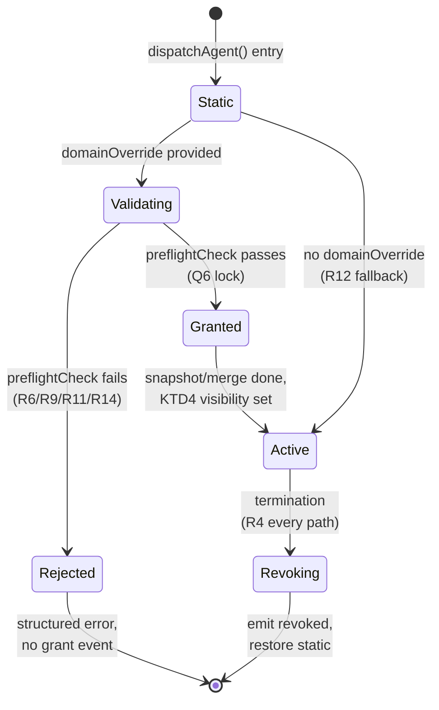

## Goal Capsule

- **Objective:** Implement the nine locked grill decisions for `domain_override`: per-call parameter on `delegate_agent` that captures-and-merges a per-dispatch delta onto the worker's static `domain:` block, enforced at every tool call, reverted on every termination path. Reserved paths and reviewer-type policy stay binding.
- **Authority hierarchy:** The grill design (`docs/per-delegation-domain-override-design.md`) is the product authority for Q1–Q9 and the 11 acceptance rows; this plan is the implementation authority. Where the plan inherits a locked decision, the grill doc carries it verbatim via `Origin`.
- **Execution profile:** code (no docs-only work, no migration, no new dependency).
- **Stop conditions:** Plan is done when all five units land in dependency order with the Verification Contract gates green and the audit event log can answer "what override was active during delegation X?" via paired `granted`/`revoked` events.
- **Tail ownership:** `ce-work` (implementation) is the consumer; this plan is a decision artifact, not a tracked work item.

---

## Product Contract

### Summary

Add `domain_override: OverrideEntry[]` to the `delegate_agent` tool. `dispatchAgent()` snapshots the worker's static `domain:` block at call entry, layers the override onto it, fires a `domain_override.granted` Hive telemetry event, runs the worker session against the merged scope, fires `domain_override.revoked` with the termination reason, and restores the static config in a `try`/`finally` so the call's lifetime ends clean. Reserved-paths enforcement and the reviewer-type policy run unchanged before and at every tool call; the override cannot loosen either fence.

### Problem Frame

In pi-hive's downstream worktree-backed workflow, coding agents must write only into a per-change worktree subdir at `APP_ROOT/.worktrees/<change-id>/<subdir>/`. The static `domain:` block in each worker `.md` cannot express this because the path contains a `<change-id>` segment that does not exist until `/hive:execute <change-id>` creates the worktree. Without a runtime override, the only options are (a) pre-author the entire worktree pattern into the static config (overshoot), (b) widen the static config to allow everything (silent overprivilege), or (c) refuse the dispatch (workflow break). All three fail least-privilege.

The override closes the gap: the dispatch site names per-dispatch paths inside the worktree; the runtime enforces them for the call; the static config reverts on return. The worker's `effective domain` is exactly `static ∪ override` and nothing more.

The load-bearing invariant: the worker must never establish or amend its own constraint. The override is set up by the dispatch site before the worker session becomes active, so the worker has no opportunity to widen its own scope. The reserved-paths fence runs before domain enforcement at every tool call, so an override that would grant `.worktrees/<id>/.env*` is rejected twice (pre-flight gate AND at the fence).

### Acceptance Examples

Each example is what the plan's tests must enforce; each cites the corresponding lock from the design doc.

- AE1. Per-call parameter mechanism.
  - **Covers:** R1, R2, R4, R5.
  - **Given:** Orchestrator calls `delegate_agent({agent: "coder", task, domain_override: [{path: ".worktrees/x/app/", upsert: true, delete: false}]})`.
  - **Then:** The override is captured in `dispatchAgent()` locals, merged onto the static config, and enforced for the call's tool turns.

- AE2. Revert on every termination path.
  - **Covers:** R4, R5, R8.
  - **Given:** A successful dispatch returns, errors, is aborted, hits budget exhaustion, or is queue-cancelled.
  - **Then:** The `try`/`finally` restores the static config in all five branches and emits `domain_override.revoked` with the matching `terminationReason`.

- AE3. Empty `domain_override: []` is no override.
  - **Covers:** R4 (boundary).
  - **Given:** A dispatch carries `domain_override: []`.
  - **Then:** No `domain_override.granted` event is emitted; merged scope equals static; tool behavior identical to an absent override.

- AE4. Pre-flight rejects reserved-path grant.
  - **Covers:** R6, R10.
  - **Given:** An override entry with `path: ".env*"` or `path: ".pi/hive/sessions/"`.
  - **Then:** `preflightCheck` returns a structured rejection; the worker never starts; no grant event emitted.

- AE5. Reviewer-type cannot mutate via override.
  - **Covers:** R9, R11.
  - **Given:** A reviewer-typed worker is dispatched with an override entry whose `upsert: true` or `delete: true`.
  - **Then:** Pre-flight rejects with "reviewer may not mutate" even if `policy.test.ts`'s reviewer-upsert test still binds the type-layer check.

- AE6. Concurrency isolation.
  - **Covers:** R7.
  - **Given:** Two `dispatchAgent()` calls run concurrently to the same worker with different overrides.
  - **Then:** Each call sees only its own effective scope; the `granted`/`revoked` pair for each call uses the correct `delegationId`; no global registry is touched.

- AE7. Conflict-worktree path support.
  - **Covers:** R4 (boundary), Q3 lock.
  - **Given:** A dispatch carries paths under `.worktrees/_conflict-<id>/...`.
  - **Then:** Pre-flight accepts; enforcement matches the override; the same audit-event shape is emitted.

- AE8. Nested delegation each has its own lifetime.
  - **Covers:** R4, R5, R7.
  - **Given:** Worker session for delegation A calls `delegate_agent` to spawn delegation B (nested).
  - **Then:** A's override remains effective for A's tool turns only; B has its own effective scope built from parent's static + B's override; both produce their own grant/revoke event pair.

- AE9. Audit telemetry completes the round trip.
  - **Covers:** R8.
  - **Given:** A delegation completes (any path).
  - **Then:** A downstream query can join `domain_override.granted` and `domain_override.revoked` by `delegationId` and reconstruct the effective scope, including `staticReference` and `overrideEntries`.

- AE10. Static config can be reasoned about post-hoc.
  - **Covers:** R8 (`staticReference`).
  - **Given:** A grant event with `staticReference` digest value `D`.
  - **Then:** A post-hoc investigation can recompute `D` from the worker's `.md` at grant time and detect a mismatch with current config.

- AE11. Inconsistent `isReadOnly` + write override is rejected.
  - **Covers:** R9.
  - **Given:** A dispatch with `isReadOnly: true` and any override entry whose `upsert` or `delete` is `true`.
  - **Then:** Pre-flight returns a structured rejection naming both parameters as inconsistent.

### Requirements

Grouped by concern. R-IDs are stable across plan revisions.

**Override interface and dispatch lifetime (capture, merge, restore):**

- R1. The `delegate_agent` tool exposes a new optional `domain_override` parameter typed as `Array<OverrideEntry>`.
- R2. Each `OverrideEntry` is the Q4 shape: `{ path: string; upsert: boolean; delete: boolean; include?: string[]; exclude?: string[] }`, a strict subset of `DomainScope`.
- R3. Only orchestrator and Operations personas may declare an override; lead/worker personas cannot.
- R4. The override lifetime is per-delegation-call: captured in `dispatchAgent()` at entry, restored on every termination path (return, error, abort, crash, budget-exhausted, queue-cancelled).
- R5. `dispatchAgent()` snapshots the static config, layers the parameter, enforces the merged scope for the call, restores the static config in a `try`/`finally`.
- R15. The override cannot violate the depth-cap invariant: a dispatch that would already be blocked at the configured depth remains blocked, regardless of override content.

**Pre-flight validation and policy binding:**

- R6. The override validator runs inline before any worker session starts; on invalid override, it returns a structured error and the worker never spawns.
- R9. `isReadOnly: true` plus any `OverrideEntry` with `upsert: true` or `delete: true` is rejected as inconsistent state.
- R10. The reserved-paths fence remains binding and runs before domain enforcement at every tool call; an override that would grant a reserved path is rejected at the pre-flight gate AND would be blocked at the fence.
- R11. Reviewer-typed agents cannot mutate via override; even a per-call grant of `upsert: true` is rejected.
- R14. The override cannot expand the agent's static budget; pre-flight rejects entries that would require more than the static budget permits.

**Audit telemetry:**

- R8. Each delegation emits two `emitHiveEvent` records: `domain_override.granted` (with `delegationId`, `dispatcher`, `dispatcherRole`, `worker`, `changeId`, `grantedAt`, `overrideEntries`, `staticReference`) followed by `domain_override.revoked` (with `delegationId`, `revokedAt`, `terminationReason`).

**Concurrency and edge cases:**

- R7. The merged scope lives in `dispatchAgent()` per-call locals keyed by `delegationId`; no global registry; concurrent calls to the same worker see their own effective scope.
- R12. Empty `domain_override: []` is treated identically to an absent parameter; no grant event, no scope widening.
- R13. Conflict-resolution worktree paths (`.worktrees/_conflict-<id>/...`) are expressible as override entries; the pre-flight gate accepts them; enforcement matches them.

### Scope Boundaries

#### Deferred for later

- **Multi-process worker sessions.** Today, workers run in the same process as the orchestrator (`src/engine/dispatch.ts:34-37`). If multi-process arrives, every worker-death path needs a cleanup hook that revokes via `domain_override.revoked`. Out of scope for this plan; tracked as a follow-up.
- **`validate_domain_override` dry-run tool.** The Q6 rejection note about a sibling validation tool is preserved here for reviewer visibility; out of scope unless surface demand emerges.
- **Per-delegation file storage.** The Q8 rejection note about an overrides-file per delegation is preserved here; out of scope unless dashboard replay demands it.

#### Outside this product's identity

- **Worker-initiated constraints.** The worker side never declares or amends an override; that authority belongs to the dispatch site only.
- **Whole-worktree grants.** The `path` is always an explicit subdir; whole-worktree grants are not expressible.
- **Read-grant via override.** The `read` field is omitted from `OverrideEntry` because Q1's read-preservation invariant must hold.
- **Cross-call overlay queries.** No "what is agent X currently scoped to?" surface; per-call local is the only state.
- **Role-level allow-list.** Q2's strongest least-privilege option (allow-list in `hive-config.yaml`) stays pending until the project's role hierarchy grows beyond orchestrator/Operations/leads/workers.

---

## Planning Contract

### Key Technical Decisions

- KTD1 — `OverrideEntry` is the Q4 shape, expressed as a `typebox` literal at `src/core/types.ts` near `DomainScope`.
  - **Rationale:** Reuses the existing validators and `include`/`exclude` semantics with a narrower required-field set; the existing `DomainScope` interface (line 77) remains canonical.
- KTD2 — `dispatchAgent()` signature gains an 8th positional `domainOverride?: OverrideEntry[]` parameter.
  - **Rationale:** Matches the verified slot (`src/engine/dispatch.ts:282` ends at `isReadOnly?`); the `delegate_agent` tool calls `dispatchAgent(state, agent, task, ctx, undefined, signal, isReadOnly)` at line 209 with `domainOverride` slotted as the 8th positional so the existing `renderCall` `flagParts` rendering (line 240) extends mechanically.
- KTD3 — Per-call local merged scope.
  - **Rationale:** Q7 lock; no global registry means no cross-call queries, no cleanup hook, no stale state. The whole lifecycle lives inside `dispatchAgent()`'s scope.
- KTD4 — The plumbing from `dispatchAgent()`'s per-call local to `enforceDomainForTool(state, event, ctx)` is a routine implementation choice.
  - **Rationale:** The design states the merged scope "plumbs through here unchanged" but does not choose between closure capture into `createSession`'s `customTools`, a transient non-global field on `state`, or a per-worker-session overlay that resets on revoke. All three are compatible with the Q7 "no global registry" constraint; the implementer picks the cleanest. Tracked as `Q-open.1` in Open Questions.
- KTD5 — The validator runs as a branch of `preflightCheck` at `src/engine/dispatch.ts:64`.
  - **Rationale:** Q6 lock; `preflightCheck` is the established extension point and its short-circuit result tuple keeps the validated/unvalidated separation visible. Adding a `domainOverride?` field to the `opts` object is mechanical; the existing `isReadOnly?` field (line 72) is the precedent.
- KTD6 — Telemetry events use the existing `emitHiveEvent` channel.
  - **Rationale:** Q8 lock; existing dashboard / archive plumbing picks up the new event types without a parallel pipeline. The hook point is `src/engine/telemetry-listeners.ts` (existing `emitHiveEvent` calls at lines 155, 173, 205, 263, 280 set the precedent).
- KTD7 — `dispatchAgent()` integrates the validator + snapshot + enforce + restore flow as one body.
  - **Rationale:** Q7 lock; the spec's invariant on every termination path is enforced by a single `try`/`finally` rather than scattered guards. The validator's short-circuit fall-through reuses the existing `preflightResult` short-circuit pattern (line 305).

### Sequencing

Unit dependencies (U-IDs stable; see Implementation Units):

```
U1  ──►  U2  ──►  U4  ──►  U5
            └──►  U3  ─────►
```

- **U1 lands first.** Locking the typebox literal and threading it through `delegate_agent` gives the schema a place to live before dispatch internals start referencing it.
- **U2 + U3 co-evolve.** `dispatchAgent()`'s snapshot/restore (U2) and `enforceDomainForTool`'s merged-scope read (U3) must work together; either order is committable as long as both tests pass together.
- **U4 follows U2.** Grant/revoke event emissions require U2's callsites.
- **U5 covers the whole feature.** Test files commit last (or with U2/U3/U4), but each unit's tests can land alongside its implementation.

### Sources & Research

- **Origin document.** `docs/per-delegation-domain-override-design.md` carries the entire product contract: problem frame, nine locked decisions, verified facts, risks, deferred items, and the open-thread closure note. This plan carries forward the design's terms (override, effective domain, delegation, static config, reserved paths, dispatch site, scope grant, scope revoke, delegation id, inconsistent state) without redefining them.
- **Verified facts (re-confirmed at plan time).** Five concrete file paths the design named were checked against current code:
  - `DomainScope` interface at `src/core/types.ts:77` — fields match (`path`, `read`, `upsert`, `delete`, optional `include`/`exclude`/`description`/`allowOutsideProject`).
  - `delegate_agent` tool at `src/agents/tools.ts:187` — schema currently `Type.Object({agent, task, isReadOnly})`; slot for `domain_override` is unclaimed.
  - `dispatchAgent` at `src/engine/dispatch.ts:278` — 7-position signature confirmed; `dispatchAgent(state, agent, task, ctx, undefined, signal, isReadOnly)` at `src/agents/tools.ts:209` matches the entry.
  - `enforceDomainForTool` at `src/engine/domain.ts:751` — signature is `enforceDomainForTool(state: HiveState, event: ToolCallEvent, ctx: ExtensionContext)`; the merged scope reaches enforce via `state`, not a parameter. **Correction to design:** the design doc's "merged effective scope plumbs through here unchanged" glosses over the mechanism (see KTD4 / `Q-open.1`).
  - Reviewer-upsert test in `tests/policy.test.ts:233` — constrains the type-layer rejection the override must respect.
- **Local patterns.** Existing telemetry channel through `emitHiveEvent` (`src/engine/observability.ts`) and the listener entry point at `src/engine/telemetry-listeners.ts` are the precedent for Q8 events. The existing `preflightCheck` at `src/engine/dispatch.ts:64` is the precedent for Q6.
- **AGENTS.md-level guardrails.** Pi-hive package rules (`pi.extensions` registration untouched; peer dependencies unchanged; no `ui/web/dist/` build needed for this feature), tool mutation queue for file writes, bounded tool output, sandbox-friendly verification surface (no `just install`, no `just verify`, no browser recipes).
- **Agent-native findings.** Skipped per the user brief: pi-hive IS the agent surface, and this feature exposes a new parameter to existing agent tools (no new tool, no new workflow automation). The relevant tool-registry surface gains one optional parameter; the relevant telemetry surface gains two event types. Both are downstream-consumer-visible contract changes, already covered by the depth Standard reclassification (5 plan units, 15 R-IDs, 11 AE-IDs).
- **External research.** Skipped per the user brief. The grill choice between the specific code locations in pi-hive (Q1–Q9) is settled; no landscape scan adds value. The implementation patterns and existing tests already in pi-hive are the strongest local grounding.

---

## High-Level Technical Design

The override lifecycle spans four engine touchpoints (tool surface, dispatch, enforcement, telemetry) with a single `try`/`finally` in `dispatchAgent()` as the load-bearing construct.

### Sequence diagram

```mermaid
sequenceDiagram
  participant Caller as Orchestrator/Operations persona
  participant Tool as delegate_agent<br/>(src/agents/tools.ts:187)
  participant Dispatch as dispatchAgent<br/>(src/engine/dispatch.ts:278)
  participant Pre as preflightCheck<br/>(src/engine/dispatch.ts:64)
  participant Tel as emitHiveEvent<br/>(src/engine/observability.ts)
  participant Worker as Worker Session
  participant Enf as enforceDomainForTool<br/>(src/engine/domain.ts:751)

  Caller->>Tool: invoke({agent, task, isReadOnly?, domain_override?})
  Tool->>Dispatch: dispatchAgent(state, agent, task, ctx, undefined, signal, isReadOnly?, domainOverride?)
  Dispatch->>Pre: preflightCheck({...opts, domainOverride})
  alt invalid override (R6/R9/R11/R14/empty)
    Pre-->>Dispatch: preflightResult = {ok:false, reason}
    Dispatch-->>Tool: {output, exitCode:1, elapsed}
    Tool-->>Caller: structured rejection
  else valid (R2/R3/R4)
    Dispatch->>Dispatch: delegationId = uuid();<br/>merged = merge(static, override);<br/>overrideVisible = set(per KTD4)
    Dispatch->>Tel: emit "domain_override.granted" (R8 full field set)
    Dispatch->>Worker: createSession(...)<br/>calls run until termination
    loop every worker tool call
      Worker->>Enf: enforceDomainForTool(state, event, ctx)
      Enf-->>Worker: merged scope applied<br/>(reads via KTD4 mechanism)
    end
    alt any termination (R4 every path)
      Dispatch->>Tel: emit "domain_override.revoked" {terminationReason}
      Dispatch->>Dispatch: overrideVisible = clear;<br/>static restored in finally
    end
    Dispatch-->>Tool: {output, exitCode, elapsed}
    Tool-->>Caller: result
  end
```

### Override lifecycle state machine



### Where the four touchpoints sit

| Touchpoint | File / function | Role |
|---|---|---|
| Tool surface | `src/agents/tools.ts`, `delegate_agent` (line 187) | Exposes `domain_override` in typebox; forwards to dispatch |
| Dispatch lifecycle | `src/engine/dispatch.ts`, `dispatchAgent` (line 278) | Validator + snapshot/merge + grant event + restore + revoke event |
| Validator | `src/engine/dispatch.ts`, `preflightCheck` (line 64) | Five rejection predicates (R6/R9/R10/R11/R14) |
| Enforcement | `src/engine/domain.ts`, `enforceDomainForTool` (line 751) | Reads merged scope via KTD4 mechanism |
| Telemetry | `src/engine/observability.ts` (`emitHiveEvent`), `src/engine/telemetry-listeners.ts` | `domain_override.granted` + `domain_override.revoked` event types |

---

## Implementation Units

### U1. `OverrideEntry` typebox + `delegate_agent` tool param wiring

- **Goal:** Expose `domain_override` on the tool surface so dispatch can receive it.
- **Requirements:** R1, R2, R3, R12 (boundary for empty array).
- **Files:**
  - `src/core/types.ts` (modified — export `OverrideEntry` typebox literal near `DomainScope`)
  - `src/agents/tools.ts` (modified — extend `delegate_agent` schema with `domain_override`, destructure the new param, forward to `dispatchAgent` as 8th positional)
- **Approach:** Lift the design's Q4 shape into a `Type.Object({path, upsert, delete, include?, exclude?})` literal; reuse the existing description-strings pattern from `Type.Object({...isReadOnly...})` in `src/agents/tools.ts:193`. The orchestrator/Operations allow-list check (R3) is on the dispatcher side; the typebox accepts the shape uniformly.
- **Patterns to follow:** The existing `isReadOnly` slot at `src/agents/tools.ts:193` (schema) and `:196` (destructure) and `:209` (call to `dispatchAgent`) is the precedent for the `domain_override` wiring. The `flagParts` rendering at `:240` extends mechanically.
- **Test scenarios:**
  - **Happy:** Tool accepts `domain_override: [{path: ".worktrees/x/app/", upsert: true, delete: false}]` and reaches `dispatchAgent` 8th positional. Input: valid shape; action: invoke via the tool's `execute`; expected: `dispatchAgent` is called with the array as 8th positional, `preflightCheck` receives it.
  - **Edge (R12):** Empty array is forwarded but `preflightCheck`'s validator treats it as no override. Input: `domain_override: []`; action: invoke; expected: no `domain_override.granted` event; tool behavior equivalent to omitting the param.
  - **Error:** Non-array value rejected by typebox. Input: `domain_override: "nope"` or missing `path`. Expected: tool returns `details: {ok: false, reason: "missing parameters" or typebox validation error}`.
  - **AE-link:** Covers AE1 (per-call parameter mechanism).

- **Verification:** When typecheck passes and the existing `tests/dispatch-usage.test.ts` continues to pass with the same call signatures that omit `domain_override`, U1 is done. A new `tests/domain-override-tool-schema.test.ts` covers the param-additive cases.

### U2. `dispatchAgent` snapshot/restore + inline validator (load-bearing)

- **Goal:** Implement the full override lifecycle inside `dispatchAgent` so the call captures the static, applies the override, fires the grant, runs the worker, fires the revoke, restores the static — on every termination path.
- **Requirements:** R4, R5, R6, R7, R8, R9, R10, R11, R13, R14, R15.
- **Files:**
  - `src/engine/dispatch.ts` (modified — extend `preflightCheck` opts, extend `dispatchAgent` signature, wrap body in `try`/`finally`, emit `domain_override.granted` at grant, emit `domain_override.revoked` in finally, restore static in finally)
  - `tests/dispatch-domain-override.test.ts` (new)
- **Approach:** Two structural moves inside `dispatchAgent`:
  1. **Pre-flight merge.** Extend `preflightCheck`'s `opts` with `domainOverride?: OverrideEntry[]` and add the validator branch. The validator runs the five rejection predicates (reserved-path entry, reviewer-type with write, budget expansion, depth-cap, inconsistent isReadOnly + write). On any rejection: `preflightCheck` returns the structured result tuple and dispatch short-circuits (matches the existing `preflightResult` short-circuit at line 305); no grant event is emitted; static is untouched.
  2. **Body wrap.** After the existing `preflightResult` short-circuit but before worker session creation, generate `delegationId`, snapshot the worker's static `domain`, compute the merged scope, set the KTD4 visibility mechanism, emit `domain_override.granted`. Wrap the rest of dispatch in a `try`/`finally` that captures the termination reason (from the existing error/abort bookkeeping), emits `domain_override.revoked` with the matching `terminationReason`, clears the KTD4 visibility, and restores the static config.
- **Patterns to follow:** Existing `preflightResult` short-circuit at `src/engine/dispatch.ts:305` is the precedent for validator fall-through. Existing error/abort bookkeeping (around line 307–309 per the design's verified facts) is the natural place to capture `terminationReason`.
- **Test scenarios:**
  - **Happy (AE2):** Valid override → grant event → worker runs → revoke event with `terminationReason: "return"` → static restored. Input: full valid `domain_override`; expected: paired grant/revoke with same `delegationId`, static config unchanged after return.
  - **Edge (AE3/R12):** Empty array → no grant, no revoke, static unchanged.
  - **Edge (AE7/R13):** Conflict-worktree path `.worktrees/_conflict-<id>/app/` accepted.
  - **Error (AE4/R10):** Reserved-path entry `.env*` rejected pre-spawn. Input: `[{path: ".env*", upsert: true, ...}]`; expected: `preflightResult` returns rejection; worker never starts; no grant emitted.
  - **Error (AE5/R11):** Reviewer-typed worker with `upsert: true` entry rejected.
  - **Error (AE11/R9):** `isReadOnly: true` plus write entry rejected with structured error naming both params.
  - **Error (R14):** Override expanding agent's static budget rejected.
  - **Error (R15):** Depth-cap violation rejected.
  - **Concurrency (AE6/R7):** Two parallel dispatches to same worker with different overrides. Expected: each `delegationId` produces exactly one grant/revoke pair; static config never observable between the calls.
  - **Termination paths (AE2):** Every post-grant path — `return`, `error`, `abort`, `crash`, `budget-exhausted`, `queue-cancelled` — produces a `revoked` event with the matching `terminationReason` and still restores the static config via `try`/`finally`. Pre-spawn validator rejections (R6/R9/R11/R14) emit no events; they short-circuit above the `try`/`finally` boundary and are covered by AE4/AE5/AE11.
  - **Nested (AE8):** Worker session for delegation A calls `delegate_agent` again. Expected: A's grant remains for A's tool turns; B gets its own grant/revoke pair against parent's static + B's override.

- **Verification:** `tests/dispatch-domain-override.test.ts` covers every termination branch by simulating each one against a mocked `createSession`. The audit log assertion joins grant/revoke pairs on `delegationId` and asserts the field set matches R8.

### U3. `enforceDomainForTool` plumbs merged scope

- **Goal:** A worker tool call enforces against the merged scope, not the static config, for the lifetime of its delegation.
- **Requirements:** R5 (enforcement half), R7 (concurrency).
- **Files:**
  - `src/engine/domain.ts` (modified — read per-call merged scope via the KTD4 mechanism, restore per-static reads after the call returns)
  - `src/engine/dispatch.ts` (modified — set/clear the KTD4 visibility lifecycle; already part of U2's wrap)
  - `tests/domain-override-enforce.test.ts` (new)
- **Approach:** The merged scope reaches `enforceDomainForTool(state, event, ctx)` via the KTD4 mechanism chosen during U2's wrap. The function's body already accepts `state` and reads from it; U3 is the read side, U2 is the write side. Three candidate mechanisms (closure capture into `createSession`'s `customTools`, transient `state` field, per-worker-session overlay that resets on revoke) are all viable — `Q-open.1` defers the choice. The test surfaces must work for any of the three.
- **Patterns to follow:** The existing `enforceDomainForTool(state, event, ctx)` at `src/engine/domain.ts:751` already takes `state`; the read happens against `state` (or a property derived from it). The function's structure is unchanged; the merge scope is read from the same channel that U2 writes.
- **Test scenarios:**
  - **Happy:** Tool call against `path` covered by `override ∪ static` succeeds. Input: dispatched worker invokes a write tool with the merged-scope `path`; expected: tool returns ok, no domain violation.
  - **Edge:** Tool call against a `path` in `static` only succeeds when the call is inside the grant lifetime.
  - **Edge:** Tool call against an `override`-only `path` after the dispatch returns is denied. Input: post-revoke tool invocation; expected: domain violation block.
  - **AE-link:** Covers AE1 (per-call mechanism) and AE6 (concurrency).
- **Verification:** `tests/domain-override-enforce.test.ts` simulates worker tool calls inside and outside the grant lifetime; the assertions are mechanism-agnostic (the merged scope is observable through whatever channel KTD4 picks).

### U4. `emitHiveEvent` `domain_override.granted` + `domain_override.revoked`

- **Goal:** Two new event types land in the existing telemetry channel; the field set matches R8.
- **Requirements:** R8.
- **Files:**
  - `src/engine/observability.ts` (modified — add the two event types to the payload contracts)
  - `src/engine/telemetry-listeners.ts` (modified if necessary — no new listener wiring if the channel already matches the type)
  - `tests/domain-override-telemetry.test.ts` (new)
- **Approach:** Add the two event types with the locked field sets:
  - `domain_override.granted`: `delegationId`, `dispatcher`, `dispatcherRole` (`"orchestrator" | "operations"`), `worker`, `changeId`, `grantedAt`, `overrideEntries` (`OverrideEntry[]`), `staticReference` (string digest).
  - `domain_override.revoked`: `delegationId`, `revokedAt`, `terminationReason` (`"return" | "error" | "abort" | "crash" | "budget-exhausted" | "queue-cancelled"`).
  Calls happen in U2's body wrap, not here. U4 owns the contract and the event-type registration.
- **Patterns to follow:** Existing `emitHiveEvent(state, "orchestrator_tool_start", {...})` calls at `src/engine/telemetry-listeners.ts:155, 173, 205, 263, 280` set the precedent for shape and channel.
- **Test scenarios:**
  - **Happy (AE9):** Two events emitted per delegation. Input: a delegation completes; expected: telemetry listener receives `domain_override.granted` first, `domain_override.revoked` second; field sets match R8.
  - **Happy (AE10):** `staticReference` is a deterministic digest of the static config. Input: same static config across two grants; expected: same `staticReference` value. Input: modified static config; expected: different value.
  - **Happy (AE2/R4):** `revoked.terminationReason` matches the actual termination path. Inputs: `return`, `error`, `abort`, `budget-exhausted`, `queue-cancelled`. Expected: each produces a `revoked` event with the matching reason.
- **Verification:** `tests/domain-override-telemetry.test.ts` exercises the listener; the dashboard or archive consumer picks up events through the existing path without any new wiring.

### U5. Tests across all spec acceptance criteria

- **Goal:** Every acceptance example in the plan has at least one matching test; the reviewer-upsert test in `tests/policy.test.ts` continues to bind.
- **Requirements:** All 15 R-IDs; AE1–AE11.
- **Files:**
  - `tests/dispatch-domain-override.test.ts` (new — covers U2 lifetime; AE1, AE2, AE3, AE4, AE5, AE6, AE7, AE8, AE11)
  - `tests/domain-override-tool-schema.test.ts` (new — covers U1 typebox; AE1)
  - `tests/domain-override-enforce.test.ts` (new — covers U3 plumbing; AE1, AE6)
  - `tests/domain-override-telemetry.test.ts` (new — covers U4 events; AE2, AE9, AE10)
  - `tests/policy.test.ts` (extended — confirms reviewer upsert still blocked even in presence of override; AE5)
- **Approach:** Per-file test scenarios are scoped to their unit; this unit ships the cross-file cohesion checks (e.g., "audit log can reconstruct any past delegation's effective scope" — a query that joins `domain_override.granted` and `domain_override.revoked` by `delegationId`).
- **Test scenarios:**
  - **Revert on every path (AE2):** Each of the five termination branches in U2 has a dedicated test.
  - **Reviewer upsert (AE5):** Even with a per-call grant, the reviewer-type layer (in `tests/policy.test.ts:233`) still fires.
  - **Concurrency collision (AE6):** Concurrent dispatch pair is observable in the audit log as two distinct, paired event sequences.
  - **Reserved-paths fence (AE4):** Override entries with `.env*` / `.pi/hive/sessions/` / `**/*.key` paths are rejected pre-spawn.
  - **Budget/depth-cap rejection:** Override expanding budget or violating depth-cap is rejected with a structured error.
  - **Audit fields populated (AE9, AE10):** Every field on both events is non-null for a successful delegation; `staticReference` is deterministic across re-grants of the same static.
- **Verification:** All five `tests/domain-override-*.test.ts` files pass; existing tests still pass; `tests/policy.test.ts` reviewer-upsert test continues to bind.

---

## Open Questions

These are implementation-time choices the design did not lock. They are routine and do not block planning; the implementer picks.

#### Q-open.1 — Plumbing mechanism between `dispatchAgent`'s per-call local and `enforceDomainForTool`

The merged scope lives in `dispatchAgent()`'s per-call locals (Q7 lock); `enforceDomainForTool(state, event, ctx)` at `src/engine/domain.ts:751` is called from worker tool turns running outside the dispatch `try`/`finally`. The implementer picks one of: closure capture into `createSession`'s `customTools`; transient non-global field on `state`; per-worker-session overlay that resets on revoke. All three are compatible with the "no global registry" constraint. The test surfaces must work for any of the three.

#### Q-open.2 — `OverrideEntry` typebox markup

The exact shape: a `Type.Object(...)` literal placed near `DomainScope` in `src/core/types.ts`, vs. a helper function, vs. a type-narrowed reuse of the existing `DomainScope` object. All three are equivalent in field set.

#### Q-open.3 — `delegationId` generation

UUID v4 (default; collision probability negligible at hive workloads) or a prefix-tagged form (e.g., `dov-<uuid>`) for log grep-ability. The design locks only the `delegationId` identifier; the algorithm is a routine choice.

#### Q-open.4 — `staticReference` digest algorithm

A deterministic digest of the static config the override layered onto. SHA-256 of the canonicalized YAML frontmatter `domain:` block (or any other stable digest) suffices; the auditor's job is to detect "this override layered onto a different static config than expected." No specific algorithm is required.

#### Q-open.5 — `dispatch.ts` insertion point

A clean insertion point inside `dispatchAgent()` after the existing `preflightResult` short-circuit at line 305 and before worker session creation. Line-number placement is a routine choice; the structural moves are fixed by U2's approach.

---

## System-Wide Impact

- **Tool surface.** `delegate_agent` gains a new optional `domain_override` parameter. The `flagParts` rendering at `src/agents/tools.ts:240` extends mechanically; an absent override renders the same as today.
- **Telemetry/dashboard.** Two new event types land in the existing `emitHiveEvent` channel. Existing listener plumbing (`src/engine/telemetry-listeners.ts`) picks them up; the dashboard archive shows them via the same capture path. Future dashboard views can render a per-delegation scope-reconstruction view without any new plumbing.
- **Concurrency model.** Per-call local (Q7 lock). Concurrent `dispatchAgent()` calls to the same worker each see their own effective scope for the duration of that call's tool turns. No global state.
- **Auth / capability boundaries.** Reserved-paths fence remains binding; reviewer-type policy remains binding. The override is a domain-layer delta that cannot loosen either fence, even when explicitly attempted (R10, R11).
- **Worker-agent perspective.** A worker session never sees its own override. The override is established by the dispatch site before the worker becomes active; the worker has no opportunity to widen its own scope.
- **Code+Security reviewers (read-only path).** Reviewer-type agents cannot mutate via override. R9 specifies that an override entry attempting to grant a reviewer write is rejected at the pre-flight gate; the reviewer type-layer check at `tests/policy.test.ts:233` is the binding second line of defense.
- **Orchestrator / Operations personas.** Both can declare an `domain_override` on `delegate_agent` calls (Q2 lock). Lead agents and workers cannot.

---

## Risks & Dependencies

- **Orchestrator crash mid-delegation (locked from design `## Risks`).** With Q7 = per-call local, the override lives in the call's locals; if the orchestrator process crashes, the in-memory grant is gone with the process. Worker sessions currently run in-process (`src/engine/dispatch.ts:34-37`'s note), so they lose their grant simultaneously. **Mitigation:** if the runtime later moves to multi-process workers, every worker-death path needs a `domain_override.revoked` cleanup hook. Tracked as `Deferred for later`; revisit when multi-process lands.
- **Spec drift in agent `.md` between grant and revoke.** If the worker's static config changes between a delegation's grant and revoke, `staticReference` records the layered-onto config; `revoked` does not need to recompute it. **Mitigation:** `staticReference` is captured at grant time only (R8); the auditor's job is to recompute against the recorded value, not current config.
- **KTD4 plumbing choice interacts with KTD3 per-call local.** A wrong plumbing pick can silently leak an override into a sibling call. **Mitigation:** U3's enforce test includes the post-revoke denial scenario (the worker's tool call after revoke must be denied). The KTD4 choice is verified by U3.
- **`tests/policy.test.ts` reviewer-upsert test must continue to bind.** R11 reuses the type-layer check; if the override path bypasses it, R11 is silently broken. **Mitigation:** U5 extends `tests/policy.test.ts` with an override-present variant of the reviewer-upsert test.
- **Empty override (`domain_override: []`) vs absent parameter.** Spec invariant §4 treats them identically. **Mitigation:** U1's `flagParts` rendering skips empty arrays; U2's validator short-circuits empty arrays to "no override" without an event. Test coverage at `tests/dispatch-domain-override.test.ts`.

---

## Verification Contract

### Commands

| Command | Purpose | Applicable to |
|---|---|---|
| `just typecheck-core` | TypeScript compilation (core sources, no tests) | After U1 typebox literal lands |
| `just typecheck-tests` | TypeScript compilation of test files | Before test commit |
| `just test` | Bun-based test suite, including `tests/dispatch-domain-override.test.ts`, `tests/domain-override-*.test.ts`, and the extended `tests/policy.test.ts` | Final gate before PR |
| `just lint` | ESLint pass | Final gate before PR |

The browser recipes `just verify`, `just ci`, `just dashboard-test-e2e` are not invoked by this plan (out of scope per project sandbox limits; not needed for this feature).

### Per-unit verification

- **U1.** `just typecheck-core` passes; `tests/domain-override-tool-schema.test.ts` passes; existing `tests/dispatch-usage.test.ts` continues to pass.
- **U2.** `tests/dispatch-domain-override.test.ts` passes including all five termination branches, concurrency, nested delegation, reserved-path rejection, reviewer rejection, depth-cap rejection, budget rejection, R9 inconsistent-state rejection.
- **U3.** `tests/domain-override-enforce.test.ts` passes including the post-revoke denial.
- **U4.** `tests/domain-override-telemetry.test.ts` passes including paired grant/revoke and `staticReference` determinism.
- **U5.** All five `tests/domain-override-*.test.ts` files pass; `tests/policy.test.ts` reviewer-upsert tests (existing + extended) pass.

---

## Definition of Done

- All five implementation units land in the dependency order described in `### Sequencing`.
- `just typecheck-core` and `just typecheck-tests` pass.
- `just test` passes for all `tests/domain-override-*.test.ts` files and the extended `tests/policy.test.ts`.
- `just lint` passes.
- Each unit's `Test Scenarios` field has at least one matching test in the named test files.
- AE1 through AE11 each have at least one matching test.
- The audit log can answer "what override was active during delegation X?" by joining the grant/revoke pair on `delegationId`.
- The conflict-resolution worktree path (`.worktrees/_conflict-<id>/...`) is covered by a regression test.
- An empty-`domain_override` test confirms `R12` behavior.
- The reviewer-upsert test in `tests/policy.test.ts` continues to bind in the presence of an override.
- No abandoned-attempt code remains in the diff (cleanup criterion — git log shows the actual landed implementation, not the iterated drafts).
- Plan artifact readiness preserved: `artifact_readiness: implementation-ready`.
